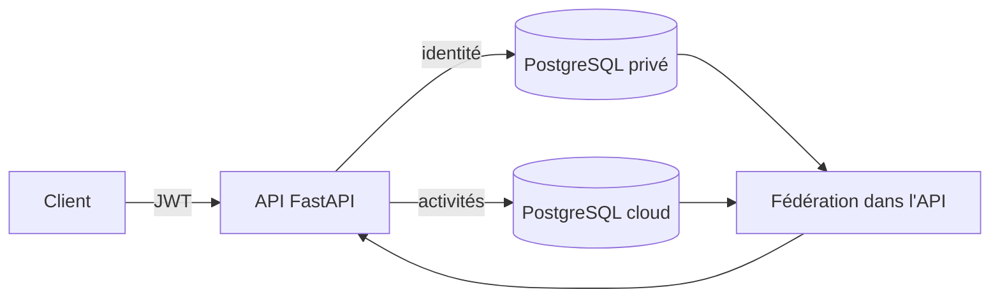

# Hybrid Data Platform

Le point de départ est simple : une association doit suivre ses adhérents et ses activités, mais les
coordonnées personnelles n'ont pas besoin de se retrouver dans la base utilisée pour les
statistiques. J'ai donc séparé les données entre deux PostgreSQL et fait le rapprochement dans
l'API. Toutes les données livrées avec le projet sont inventées.

Le projet utilise FastAPI et deux bases PostgreSQL :

- la base privée contient le nom, l'adresse électronique, le code postal et le consentement ;
- la base cloud contient uniquement une référence d'adhérent, le programme et le nombre d'heures.

FastAPI interroge chaque base séparément, puis assemble la réponse. Il n'y a ni jointure SQL ni clé
étrangère entre les deux serveurs. Le projet ne dépend d'aucune plateforme métier externe.



## Contenu du projet

- API REST FastAPI et schéma OpenAPI ;
- deux moteurs SQLAlchemy avec un routage explicite ;
- lecture fédérée et calcul des totaux par programme ;
- authentification JWT à partir d'un formulaire OAuth2 ;
- un historique Alembic par base ;
- Docker Compose avec réseaux internes séparés ;
- tests rapides sur SQLite et test d'intégration PostgreSQL en CI ;
- Ruff, audit des dépendances et construction de l'image dans GitHub Actions.

## Lancer la version locale

Prérequis : Python 3.11 ou plus récent, Docker Desktop et Docker Compose.

```powershell
python scripts/create_env.py
docker compose up --build -d
docker compose ps
```

Le script crée `.env` avec des secrets propres à la machine et affiche les identifiants de
connexion. Le fichier n'est pas suivi par Git. Swagger est ensuite disponible sur
<http://localhost:8000/docs>.

## Parcours de test

1. Générer un jeton avec `POST /api/v1/auth/token`.
2. Créer un adhérent avec `POST /api/v1/members`.
3. Copier son identifiant dans une participation créée avec `POST /api/v1/participations`.
4. Consulter `GET /api/v1/federated/members/{id}`.
5. Vérifier les totaux avec `GET /api/v1/federated/overview`.

Lorsque `SEED_DEMO_DATA=true`, Camille Martin et deux participations fictives sont ajoutées lors du
premier démarrage.

## Utiliser une vraie base distante

Le second fichier Compose conserve PostgreSQL privé sur le poste et utilise Supabase pour la base
d'activités.

```powershell
python scripts/create_env.py --hybrid
docker compose --env-file .env.hybrid -f compose.hybrid.yaml up --build -d
```

L'URL Supabase est demandée avec une saisie masquée. Elle n'apparaît donc ni dans le dépôt ni dans
l'historique PowerShell. La procédure complète se trouve dans
[docs/deployment.md](docs/deployment.md).

Après authentification, `GET /api/v1/deployment-info` indique si l'API fonctionne en mode local ou
hybride, sans renvoyer les chaînes de connexion.

## Tests

```powershell
python -m pip install -e ".[dev]"
python -m ruff check .
python -m pytest -m "not integration"
python -m pip check
python -m pip_audit . --progress-spinner off
```

Les tests locaux emploient deux bases SQLite temporaires. La CI applique aussi les migrations et
exécute un parcours complet sur deux services PostgreSQL. Le seuil de couverture est fixé à 85 %.

## Limites du prototype

- Le compte de gestion est défini dans l'environnement. Plusieurs utilisateurs demanderaient un
  fournisseur d'identité et des rôles.
- Une création d'adhérent et une création de participation sont deux opérations distinctes. Il n'y a
  pas de transaction distribuée.
- La fédération actuelle convient à un petit volume. Pour aller plus loin, il faudrait préparer les
  agrégats ou ajouter un traitement asynchrone.

Des notes complémentaires sont disponibles dans
[docs/architecture.md](docs/architecture.md), [docs/api.md](docs/api.md) et
[docs/decisions.md](docs/decisions.md).

## Formulation CV

**Hybrid Data Platform — projet personnel (Python, FastAPI, PostgreSQL, Docker)**

- conception d'une API séparant données personnelles locales et activités pseudonymisées distantes ;
- mise en place d'une fédération applicative, de JWT et de migrations Alembic par base ;
- automatisation des tests PostgreSQL, du lint et du build Docker avec GitHub Actions.

Licence MIT — Nassir Chaabani.
